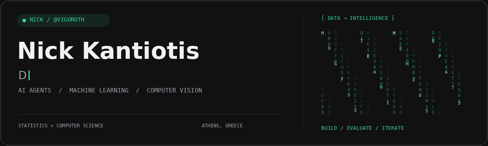
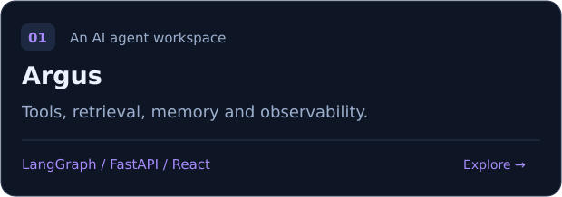
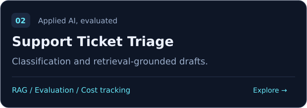
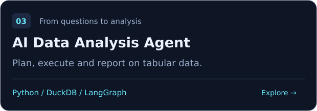
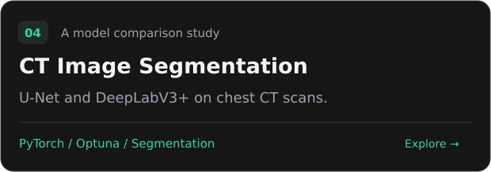
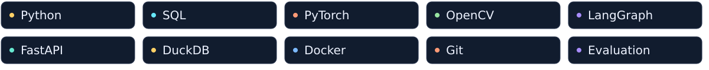

<a href="https://my-portfolio-umber-eight-91.vercel.app">
<picture>
  <source media="(prefers-reduced-motion: reduce)" srcset="./assets/header-static.png">
  
</picture>
</a>

  <a href="https://my-portfolio-umber-eight-91.vercel.app">Portfolio</a> ·
  <a href="https://www.linkedin.com/in/nick-kantiotis/">LinkedIn</a> ·
  <a href="https://dione.lib.unipi.gr/xmlui/handle/unipi/17827">Master's thesis</a> ·
  <a href="#selected-projects">Projects</a>

## Hi, I'm Nick

I'm a **Data Scientist based in Athens**, with a **BSc in Statistics & Insurance Science** and an **MSc in Computer Science**. My professional background is in pharmaceutical analytics, connecting complex data with business decisions.

My projects connect data, machine learning and software engineering: from computer vision experiments to AI agents that use tools and retrieve information. I focus on making the methods, evaluation and practical limitations clear.

## Selected projects

<table>
  <tr>
    <td width="50%"></td>
    <td width="50%"></td>
  </tr>
  <tr>
    <td width="50%"></td>
    <td width="50%"></td>
  </tr>
</table>

**Also in computer vision:** [Basketball detection and dataset creation](https://github.com/vigoroth/basketball_tracking_dataset_app) · [Classical lane detection](https://github.com/vigoroth/classical-lane-detection) · [Inverse perspective mapping](https://github.com/vigoroth/ipm-perspective-transform)

## Technical toolkit

| Area | What I work on |
| --- | --- |
| Data science | Data preparation, statistical analysis, model comparison and experiment design |
| AI engineering | Retrieval, tool-using agents, APIs and evaluation |
| Computer vision | Object detection, image segmentation and geometric transformations |

## Research & learning

My master's thesis focuses on **object detection in basketball game videos**, connecting deep learning with sports video analysis. [Read the thesis](https://dione.lib.unipi.gr/xmlui/handle/unipi/17827).

## Currently exploring

- **RAG systems:** retrieval strategies, grounded answers and reproducible evaluation.
- **Reliable AI agents:** tool use, tests, observability and cost measurement.
- **Vision-language models:** connecting visual information with language.

---

Statistics + Computer Science · From data to working systems.

